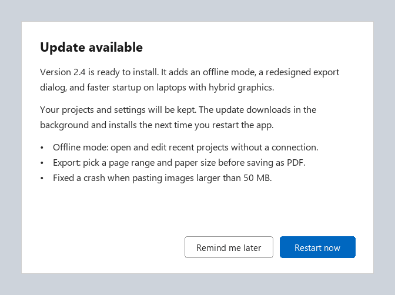
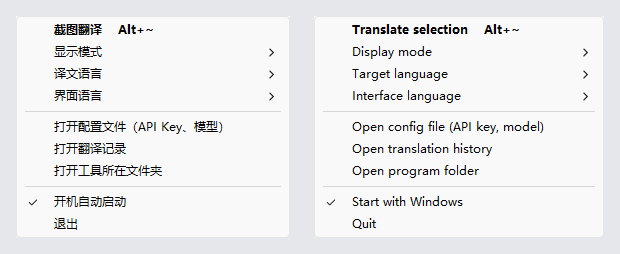
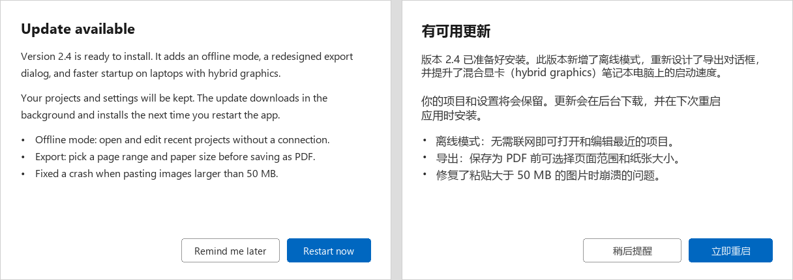
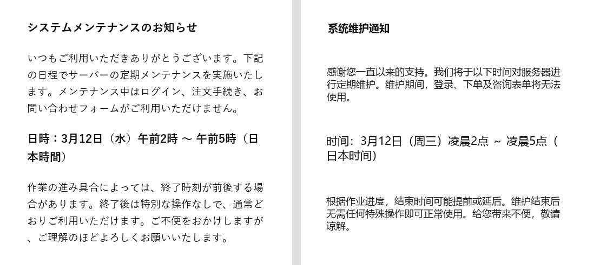

# Metaphrasis

Screen translation for Windows. Press a hotkey, drag a box around any text on the screen, and a few seconds later the translation is drawn over the original, in the same size, weight and alignment. The translating is done by a large language model through your own API key: Claude, or any service whose API follows the OpenAI format (ChatGPT, DeepSeek, Qwen, Kimi, Gemini, a local Ollama).

<p align="center"></p>

It translates into Chinese by default; the target can be switched to English, Japanese or any other language from the tray menu or the config file. The interface follows your Windows language (English, Simplified and Traditional Chinese, Japanese, Korean) and can be switched from the tray menu too. [中文说明](README.zh-CN.md)

The tray menu, Chinese and English interface:

<p align="center"></p>

<p align="center"></p>

## Why

If you have an AI API key and want it to do something useful day to day, try this. There are plenty of translation extensions for browsers. Outside the browser, in desktop apps, chat windows, PDF readers, a paused video, I never found one I liked, and machine translation is hard to read. This fills that gap.

What it costs depends on the model. Here is my own usage for the last 30 days, from the Claude Console, filtered to the key this tool uses:

<p align="center"></p>

875,393 input tokens, 160,926 output tokens, roughly 440 translations, almost all on Fable 5.1. The orange and green slivers are the automatic switch to another model after a refusal. How I use it: small regions only (a dialog, a chat message, a few lines of docs), `effort = low`, about 2,000 tokens sent per call (mostly the screenshot) and 400 back. At list prices, including the few days on a second key after a key rotation, the month came to about $18.

The same tokens at list prices:

| Model | Per translation | This month |
|---|---|---|
| Claude Fable 5.1 (what I use) | about $0.04 | about $18 |
| Claude Opus 5.5 | about $0.015 | about $7.2 |
| Claude Sonnet 5.5 (default for new installs) | about $0.008 | about $3.6 |
| Claude Haiku 5.5 | about $0.0004 | about $0.18 |

Sonnet is good enough. Full-screen captures, long articles and higher effort cost noticeably more. DeepSeek-style endpoints are another order of magnitude cheaper.

## Install

Two ways, pick one.

**A. Download and run, no Python needed**: get `Metaphrasis-<version>-win64.zip` from [Releases](../../releases), unzip it anywhere, double-click `start.bat`. The zip carries a trimmed Python and every dependency; nothing on the system is touched, and deleting the folder uninstalls it. The first run may show "Windows protected your PC": click "More info", then "Run anyway".

**B. You already have Python**:
1. Python 3.11 or newer (I use 3.14). Tick "Add Python to PATH" in the installer.
2. Download the source (Code → Download ZIP), unzip, double-click `install.bat`. It sets up the dependencies, about a minute.
3. Double-click `start.bat`.

Either way, the first run creates `config.ini` in the folder. Open it in Notepad, paste your key after `api_key =`, save. It takes effect right away, no restart.

The default is Claude. For anything else, set `provider` to `openai` and fill in `base_url` and `model`; the file lists common endpoints and model names (ChatGPT, DeepSeek, Qwen, Kimi, GLM, Gemini, local Ollama).

`target_language` defaults to Chinese. Write any language there, English, 日本語, 한국어, or pick one from the tray menu; the source can be anything, including Chinese. English runs about twice as long as Chinese, so Chinese-to-English overlays come out in smaller type; popup mode doesn't have that problem.

Models that can't take images, such as DeepSeek's main model, still work: the tool sends text only. But then Japanese and Korean won't translate, because that text comes from the Windows OCR engines for English and Chinese.

The interface language follows Windows by default; the tray menu switches between English, Simplified Chinese, Traditional Chinese, Japanese and Korean. The explanations inside the config file come in Chinese and English and follow the interface language.

Windows 10 / 11 only.

## Use

| Key | What it does |
|---|---|
| Alt + ~ | Select a region and translate (~ is the key below Esc) |
| Ctrl + Alt + Y | Switch between overlay and popup mode |
| Esc | Cancel the selection, or close the result |

Drag the box, wait for the green spinner, the translation appears in place. It stays until you press Esc or close it from the right-click menu; you can drag it around and hold Space to peek at the original. Right-click on it to copy the image, copy the text, save the image, or translate again.

In popup mode the translation is plain text in a window, already on the clipboard, and you can select part of it to copy.

<p align="center"></p>

Right-click the tray icon for: display mode, target language, interface language, open the config file, open the history, start with Windows, quit.

If the selection is already in the target language, no API call is made.

## Japanese and other languages

Windows OCR has no Japanese pack by default and it doesn't matter: the screenshot goes to the model anyway and the model reads it. With the Japanese language pack installed the placement is more accurate; without it, placement is estimated with the Chinese engine. Same for Korean and Russian.

<p align="center"></p>

The other direction works too. This is English to Japanese with `target_language = 日本語`; the font switches to Yu Gothic on its own:

<p align="center"></p>

## Refusals

The safety filters of AI services sometimes misfire, most often when the screenshot mentions keys, passwords or permissions, and the request comes back refused instead of translated. It happened to me a lot and it was annoying, so there are a few layers now:

Before sending, anything that looks like a key, a path or an environment variable name is swapped for a placeholder and put back afterwards. If the request is still refused, it is retried on a model with a looser filter (Claude only: Fable's filter is the strictest, Sonnet's is looser; other APIs skip this step). Still refused, it is sent as text only, without the image. As a last resort the text is translated four lines at a time; the blocked lines are marked and the rest come through. In practice a selection almost never comes back empty.

## Privacy, and whether files pile up

Nothing is kept by default. No log of sources and translations, no screenshots. Quit the program and the folder has gained one log file (1 MB at most, in English); it records timings and errors, never the text you translated.

If you want records, there are two options under `[options]` in `config.ini`:

- `save_history = true` appends each source and translation to `翻译记录.txt`.
- `save_images = true` saves the rendered screenshot into the `保存的译文` folder, by date. Clean it out now and then, it grows.

The selected region is sent as an image, exactly as it looks, to the one endpoint you configured and nowhere else; whatever is visible in the selection, a key or a password included, is seen by that provider. Plain `http://` endpoints are refused unless they are on this machine or the local network. The key lives only in `config.ini`; the program never reads or writes environment variables. Anything that looks like a key is masked before it reaches the history file.

## FAQ

Hotkey registration failed: another program has that combination. Change it under `[hotkey]` in `config.ini` and restart.

Can't connect: if you need a proxy, set `proxy` in `config.ini`, for example `http://127.0.0.1:7890`.

Key expired: keys created in the Claude Console expire after 30 days by default, pick Never when creating one. Paste the new key into `config.ini`, no restart needed.

The program is gone: if there is no tray icon, double-click `start.bat` again. If something else killed it, `guard.pyw` brings it back within a few seconds.

## Limitations

OCR is the one built into Windows. Small text, decorative fonts and busy backgrounds trip it up; it is not PaddleOCR. Each translation takes three to eight seconds, which is how fast the model is, slower than machine translation. It does not follow scrolling and there is no side-by-side web page mode; it is not a replacement for immersive-translate style extensions. When the translation is much longer than the original, the text gets smaller or a bit cramped.

## Files

```
start.bat       start (installs the environment on first run)
install.bat     reinstall the environment
guard.pyw       watchdog: starts the main program, restarts it if it dies
fanyi.py        main program: tray, hotkey, selection, display
translator.py   calls the API (Claude / OpenAI-compatible), the anti-refusal layers live here
render.py       lays the translation back over the original
ocr_win.py      Windows OCR
settings.py     config, history
i18n.py         interface strings in five languages
tools/          script that builds the portable zip
other .py       small helpers
```

MIT license, change whatever you like. Issues and PRs are welcome, replies may be slow.

The name is Greek: metaphrasis.
