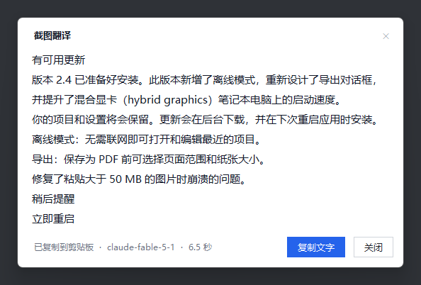
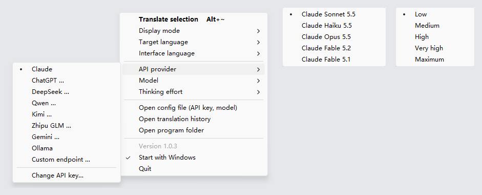
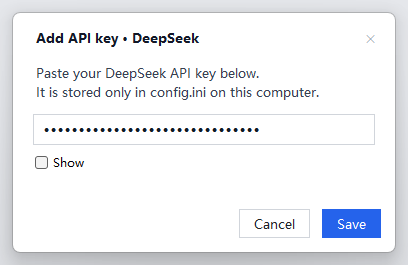
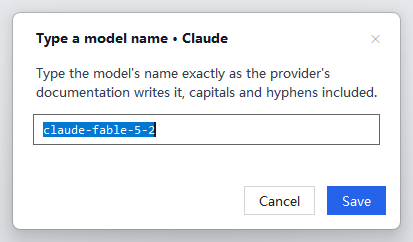
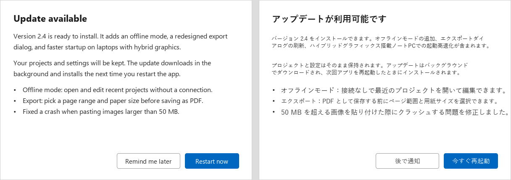
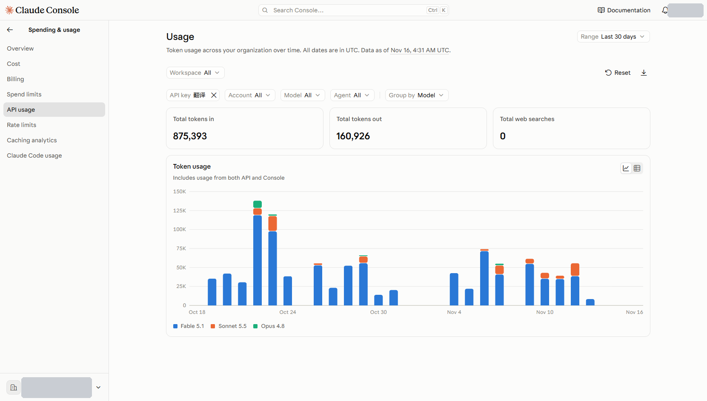

<p align="center"></p>

# Metaphrasis

[中文说明](README.zh-CN.md)

A small translation tool for Windows that runs on your own AI API key. It does two things:

- **Screen translation.** Press Alt + ~, drag a box around any text on the screen, and a few seconds later the translation is drawn over the original, in the same size, weight and alignment.
- **Convert what you typed.** Anywhere you can type, write in your own language, press Alt + 1, and what is in the input box is replaced in place by natural English (or another language you pick). English you typed yourself gets tidied up too.

<p align="center"></p>

<p align="center"></p>

There are plenty of translation extensions for browsers. Outside the browser, in desktop apps, chat windows, PDF readers, a paused video, I never found one I liked, and machine translation is hard to read. This fills that gap. If you have an AI API key and want it to do something useful day to day, try it.

It translates from any language into any language. The interface comes in English, Simplified Chinese, Traditional Chinese, Japanese and Korean. Windows 10 / 11 only.

## Supported providers and models

The translating is done by a large language model. All of these providers are in the tray menu; click one, paste its key, and it works:

| Provider | Models |
|---|---|
| Claude (default) | Fable 5.2, Fable 5.1, Opus 5.5, Sonnet 5.5 (default for new installs), Haiku 5.5 |
| ChatGPT | gpt-6.2-sol and others |
| DeepSeek | deepseek-flash, deepseek-v4-pro and others |
| Qwen | qwen4-max and others |
| Kimi | kimi-k3.1-pro and others |
| GLM | glm-5.3-flash and others |
| Tencent Hunyuan | hy4, hy4-flash and others |
| Gemini | the Gemini 4 family and others |
| Grok | whatever your account can use |
| Ollama | the local models installed on your own machine; no key needed |
| Custom endpoint | any other endpoint that speaks the OpenAI format; just give its address |

- **The model list is looked up, not built in.** Claude has a fixed list of five. For every other provider the program asks the provider itself which models your account can use, once its key is saved (a free request), and the menu lists what comes back; the names in the table are only examples from November 2026. So when a provider brings out a new model, you can pick it without waiting for this program to be updated. A model that is not in the list can be typed in by name.
- **Both features work with every provider.** Screen translation and converting what you typed do not depend on which one you use.
- **Reading the screenshot.** Claude's models all read the screenshot directly. With the other providers it depends on the model: one that takes images gets the image; one that does not is noticed, and gets only the recognised text. With text only, Japanese and Korean won't translate, because that text comes from the Windows OCR engines for English and Chinese.
- **Thinking effort can be set for every provider**, each with its own choices. Switching to another model automatically after a safety filter refuses by mistake is something only Claude has.
- **What has been tested.** I only have a Claude key, so Claude is the only provider tested against the real service. The others follow each company's API documentation as of November 2026 and were checked against a local stand-in. If one of them misbehaves for you, please open an issue.

How to pick a provider, enter its key, choose a model and set the effort is under [Provider, model and thinking effort](#provider-model-and-thinking-effort).

## Install

Two ways, pick one.

**A. Download and run, no Python needed**: get `Metaphrasis-<version>-win64.zip` from [Releases](../../releases), unzip it anywhere, double-click `start.bat`. The zip carries a trimmed Python and every dependency; nothing on the system is touched, and deleting the folder uninstalls it. The first run may show "Windows protected your PC": click "More info", then "Run anyway".

**B. You already have Python**:
1. Python 3.11 or newer (I use 3.14). Tick "Add Python to PATH" in the installer.
2. Download the source (Code → Download ZIP), unzip, double-click `install.bat`. It sets up the dependencies, about a minute.
3. Double-click `start.bat`.

Either way, the next step is the key. Right-click the tray icon, open **API provider**, click your provider and paste the key into the box that comes up. It is written to `config.ini` in the program folder and takes effect right away, no restart. Editing `config.ini` in Notepad works too: paste the key after `api_key =`.

The default provider is Claude; the others are in the same menu.

## Use

| Key | What it does |
|---|---|
| Alt + ~ | Select a region and translate (~ is the key below Esc) |
| Ctrl + Alt + Y | Switch between overlay and popup mode |
| Alt + 1 | Convert what you typed: the text in the input box is replaced in place by another language |
| Esc | Cancel the selection, close the result, or cancel a conversion that is under way |

Drag the box, wait for the green spinner, the translation appears in place. It stays until you press Esc or close it from the right-click menu; you can drag it around and hold Space to peek at the original. Right-click on it to copy the image, copy the text, save the image, or translate again.

In popup mode the translation is plain text in a window, already on the clipboard, and you can select part of it to copy.

<p align="center"></p>

If the selection is already in the target language, no API call is made.

Everything else is in the tray icon's right-click menu: display mode, target language, convert typed text to, interface language, API provider, model, thinking effort, open the config file, open the history, start with Windows, quit. The Chinese and the English interface:

<p align="center"></p>

## Convert what you typed

It works anywhere you can type: a chat window, a search box, an input box on a web page, a document. Write in your own language, press Alt + 1, and the text in the input box is replaced in place by another language, English by default. The wording is conversational, the way a native speaker would put it in a chat, not a word-for-word translation.

<p align="center"></p>

| You typed | After Alt + 1 |
|---|---|
| 好的，我明天再回你，今天有点忙 | Okay, I'll get back to you tomorrow, I'm a bit busy today. |
| I'll send you the file 等我回家 | I'll send you the file when I get home |
| can you tell me where is the station | Can you tell me where the station is? |
| pls check the readme.md on github, john said its wrong | Please check the readme.md on GitHub, John said it's wrong. |

- With nothing selected the whole input box is converted; with a selection, only that part.
- Text that is already in the target language is not handed back as typed: spelling, grammar, word order, capital letters and punctuation are put right. File names, paths, commands and code are left alone, letter for letter.
- Pick the language under **Convert typed text to** in the tray menu, or write `convert_language` in `config.ini`; any language works. To change the hotkey, add a line `convert = <keys>` under `[hotkey]`; to do without the feature altogether, write `convert = off` there, and Alt + 1 stays with your other programs.
- Changed your mind while it is working? Press Esc: the conversion is cancelled at once and the text in the box stays as it was. If the program had selected the text itself, the selection is taken away again, so that typing on does not wipe your message. Once the text has started going in, it is too late.
- What goes in is real text: Ctrl + Z in that program takes it back.
- If you click somewhere else while it is working, that is fine: once your hands have been off the keyboard for a moment, the program goes back to the input box, replaces the text, and returns you to where you were. If it cannot get back (you are busy typing somewhere else, say), or the box no longer holds what it held, it leaves the box alone, puts the result on the clipboard and tells you to paste it.
- Up to 5,000 characters at a time.

Keys are only ever sent to a place Windows confirms is a text box. The text of a web page, pictures, read-only text, checkboxes, drop-down lists and sliders are never touched, and what is in a password field is never read. Terminal windows are left alone too (the Windows console, Windows Terminal, the terminal inside VS Code): Ctrl + C and Ctrl + V mean something else there.

The text travels through the clipboard (Ctrl + C / Ctrl + V), because that is the one way every program supports. Whatever was on your clipboard before (text, a picture, copied files) is put back afterwards, and something you copy yourself while a conversion is running is left as it is. If the clipboard holds something that could not be put back (something very large, or of a kind only its own program understands), nothing is converted and you are told why. One thing is outside the program's reach: with Windows clipboard history (Win + V) switched on, the text you converted shows up in that list, because it is the other program that copies it.

Some programs do not tell Windows where their input boxes are. There it says "This is not a place you can type in" and does nothing. I have tested it in browsers (Edge and other Chromium-based windows) and in plain Windows text boxes; other programs may or may not work, and if one does not, please open an issue.

## Provider, model and thinking effort

All three are in the tray menu, and they are set up in that order: provider first, then its key, and only then model and effort. Until the provider in use has a key, **Model** and **Thinking effort** stay greyed out.

<p align="center"></p>

**API provider.** A name that ends in … has no key yet. Clicking it asks for the key first, and nothing changes until you save; cancel and you are where you were. A provider that already has a key is switched to at once. **Change API key…** at the bottom replaces the key of the provider in use, which is what you want when a key expires.

<p align="center"></p>

The key is shown as dots unless you tick Show, so a screenshot of the box does not give it away. Each provider keeps its own key, model and effort in `config.ini`. Switching puts the outgoing provider's settings aside and brings the incoming one's back, so a key is never sent to a company it does not belong to.

**Model.** Claude has a fixed list of five. For the other providers the list is asked of the provider itself once its key is saved (a free request), so it shows what your account can actually use. If the model you want is not listed, or the list could not be fetched, click **Type a model name…** at the bottom of the Model menu and type the name into the small box that opens; no restart needed. A wrong name does no harm: the first time it is used the provider says there is no such model, and the program tells you.

<p align="center"></p>

**Thinking effort.** How long the model reasons before it answers: more is slower and costs more, and for a few lines of interface text the lowest setting is enough. Every provider has its own choices, because every API does this differently:

| Provider | Choices |
|---|---|
| Claude | Low, Medium, High, Very high, Maximum |
| ChatGPT | Default, Thinking off, Low, Medium, High, Very high, Maximum |
| DeepSeek | Default, Thinking off, Low, High, Maximum |
| Qwen | Default, Thinking off, Thinking on, Low, High, Very high |
| Kimi | Default, Low, High, Maximum |
| GLM | Default, Thinking off, Low, High, Maximum |
| Tencent Hunyuan | Default, Thinking off, Low, Medium, High |
| Gemini | Default, Minimal, Low, Medium, High, Very high |
| Grok | Default, Low, Medium, High, Very high |
| Ollama | Default, Thinking off, Low, Medium, High |

Default sends nothing and leaves it to the model. Some providers have no off switch because their current models always think. Within one provider, older and newer models do not accept the same choices:

- If you chose **Thinking off** and the model cannot stop thinking (the newest flagship models of several providers cannot), the request is sent again with that provider's lowest level. What you asked for is less thinking, not the model's own default, which is usually a lot.
- If a model turns any other level down, the request is sent again without the setting, so the translation still arrives, at that model's default.
- The same goes for the length of the answer: a model that allows less output than the program asks for (older models often do) is asked again for what it allows.

In each case the extra request (two at the very most) is only made the first time: the program remembers what that model accepts for as long as it is running, and starts there the next time.

## Languages

**Target language.** `target_language` starts out as your Windows display language when that is Chinese, Japanese or Korean, and as English otherwise. Write any language there, English, 日本語, 한국어, or pick one from the tray menu; the source can be anything, including Chinese. English runs about twice as long as Chinese, so Chinese-to-English overlays come out in smaller type; popup mode doesn't have that problem.

**Interface language.** It follows Windows by default; the tray menu switches between English, Simplified Chinese, Traditional Chinese, Japanese and Korean. The explanations inside the config file come in Chinese and English and follow the interface language.

**Japanese and other languages.** Windows OCR has no Japanese pack by default and it doesn't matter: the screenshot goes to the model anyway and the model reads it. With the Japanese language pack installed the placement is more accurate; without it, placement is estimated with the Chinese engine. Same for Korean and Russian.

<p align="center"></p>

The other direction works too. This is English to Japanese with `target_language = 日本語`; the font switches to Yu Gothic on its own:

<p align="center"></p>

## What it costs

What it costs depends on the model. Here is my own usage for the last 30 days, from the Claude Console, filtered to the key this tool uses:

<p align="center"></p>

875,393 input tokens, 160,926 output tokens, roughly 440 translations, almost all on Fable 5.1. The orange and green slivers are the automatic switch to another model after a refusal. How I use it: small regions only (a dialog, a chat message, a few lines of docs), `effort = low`, about 2,000 tokens sent per call (mostly the screenshot) and 400 back. At list prices, including the few days on a second key after a key rotation, the month came to about $18.

The same tokens at list prices:

| Model | Per screen translation | This month |
|---|---|---|
| Claude Fable 5.1 (what I use) | about $0.04 | about $18 |
| Claude Fable 5.2 | about $0.03 | about $14.4 |
| Claude Opus 5.5 | about $0.015 | about $7.2 |
| Claude Sonnet 5.5 (default for new installs) | about $0.008 | about $3.6 |
| Claude Haiku 5.5 | about $0.0004 | about $0.18 |

Sonnet is good enough. Full-screen captures, long articles and higher effort cost noticeably more. DeepSeek-style endpoints are another order of magnitude cheaper.

Converting what you typed costs less than a screen translation because no image is sent: a little over 800 tokens go out (mostly the fixed instructions) and from a few dozen to a hundred-odd come back. At list prices:

| Model | Per conversion |
|---|---|
| Claude Fable 5.1 (what I use) | about $0.01 to $0.02 |
| Claude Fable 5.2 | about $0.01 |
| Claude Opus 5.5 | about $0.005 |
| Claude Sonnet 5.5 (default for new installs) | about $0.003 |
| Claude Haiku 5.5 | under $0.0002 |

## Refusals

The safety filters of AI services sometimes misfire, most often when the screenshot mentions keys, passwords or permissions, and the request comes back refused instead of translated. It happened to me a lot and it was annoying, so there are a few layers now:

Before sending, anything that looks like a key, a path or an environment variable name is swapped for a placeholder and put back afterwards. If the request is still refused, it is retried on a model with a looser filter (Claude only: Fable's filter is the strictest, Sonnet's is looser; other APIs skip this step). Still refused, it is sent as text only, without the image. As a last resort the text is translated four lines at a time; the blocked lines are marked and the rest come through. In practice a selection almost never comes back empty.

## Privacy, and whether files pile up

Nothing is kept by default. No log of sources and translations, no screenshots. Quit the program and the folder has gained one log file (1 MB at most, in English); it records timings and errors, never the text you translated.

If you want records, there are two options under `[options]` in `config.ini`:

- `save_history = true` appends each source and translation to `翻译记录.txt`.
- `save_images = true` saves the rendered screenshot into the `保存的译文` folder, by date. Clean it out now and then, it grows.

The selected region is sent as an image, exactly as it looks, to the one endpoint you configured and nowhere else; whatever is visible in the selection, a key or a password included, is seen by that provider. Plain `http://` endpoints are refused unless they are on this machine or the local network. The key lives only in `config.ini`; the program never reads or writes environment variables. Anything that looks like a key is masked before it reaches the history file.

Converting what you typed sends the text of that one input box (the selection, or the whole box) to the endpoint you configured, at the moment you press the hotkey, and nothing else; password fields are never read. The log records only lengths and timings. With `save_history` on, conversions are recorded as well.

## FAQ

Hotkey registration failed: another program has that combination. Change it under `[hotkey]` in `config.ini` and restart.

Can't connect: if you need a proxy, set `proxy` in `config.ini`, for example `http://127.0.0.1:7890`.

Key expired: keys created in the Claude Console expire after 30 days by default, pick Never when creating one. To put in a new key, right-click the tray icon, **API provider** → **Change API key…**; no restart needed.

Alt + 1 says "This is not a place you can type in": click inside the input box first so the caret is in it, then press the key. If it still says so, that program does not tell Windows it is an input box; see [Convert what you typed](#convert-what-you-typed).

Which version am I running: right-click the tray icon; it is the grey line near the bottom of the menu.

The program is gone: if there is no tray icon, double-click `start.bat` again. If something else killed it, `guard.pyw` brings it back within a few seconds.

## Limitations

OCR is the one built into Windows. Small text, decorative fonts and busy backgrounds trip it up; it is not PaddleOCR. Each translation takes three to eight seconds, which is how fast the model is, slower than machine translation. It does not follow scrolling and there is no side-by-side web page mode; it is not a replacement for immersive-translate style extensions. When the translation is much longer than the original, the text gets smaller or a bit cramped. Converting what you typed depends on the program telling Windows where its input boxes are; in programs that do not, it cannot be used.

## Files

```
start.bat       start (installs the environment on first run)
install.bat     reinstall the environment
guard.pyw       watchdog: starts the main program, restarts it if it dies
fanyi.py        main program: tray, hotkey, selection, display
translator.py   calls the API (Claude / OpenAI-compatible), the anti-refusal layers live here
render.py       lays the translation back over the original
gdi_text.py     draws the text with Windows' own renderer, as sharp as the text around it
ocr_win.py      Windows OCR
inputbox.py     converting what you typed: finds the input box, takes the text, puts the result back
settings.py     config, history
i18n.py         interface strings in five languages
appicon.py      the icon, drawn in code (there is no picture file)
tools/          script that builds the portable zip
tests/          the checks the program was developed against: python tests\run_all.py (no key needed, nothing is sent)
other .py       small helpers
```

MIT license, change whatever you like. Issues and PRs are welcome, replies may be slow.

The name is Greek: metaphrasis.
