<p align="center">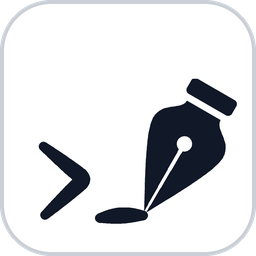</p>

# Metaphrasis

[English](README.md)

Windows 上的截图翻译。按个快捷键，框住屏幕上一块文字，几秒后译文直接盖在原来的位置上，字号、粗细、对齐都照着原文。翻译是用你自己的 API 调大模型做的，Claude 可以，任何用 OpenAI 格式接口的服务也可以（ChatGPT、DeepSeek、通义千问、Kimi、Gemini、本地 Ollama）。默认翻成中文，在配置里改一个词就能翻成英文、日文或别的语言。

<p align="center">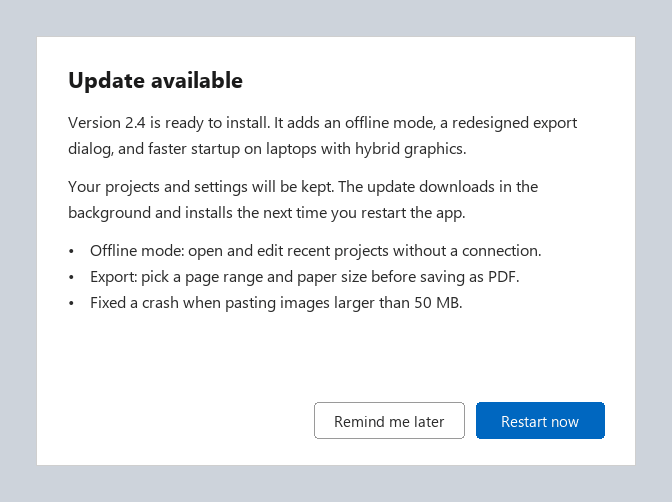</p>

还有一个打字用的功能：在任何能打字的地方，用中文打完按 Alt + 1，输入框里的字原地换成地道的英文（或者你选的别的语言），自己打的英文也会顺手改好。见[输入框转换](#输入框转换)。

托盘菜单，中文和英文界面：

<p align="center">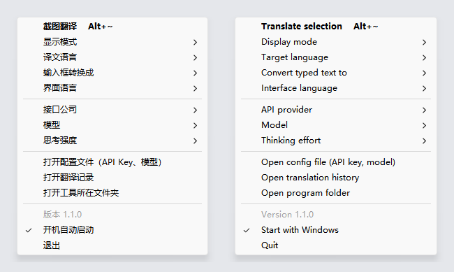</p>

<p align="center">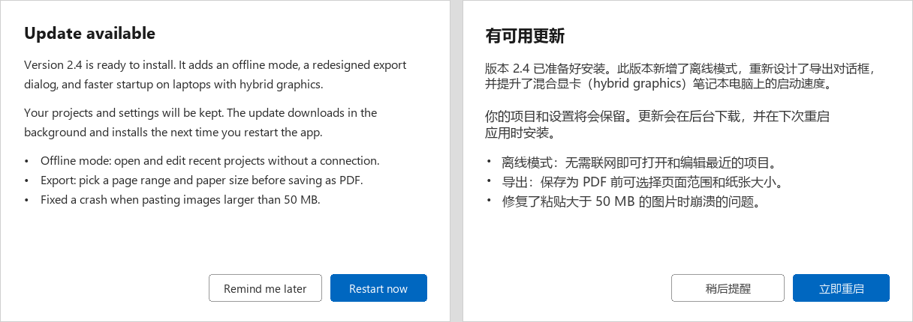</p>

## 为什么有这个

如果你有一个 AI 的 API Key，想让它干点实际的事，可以试试这个。浏览器里的翻译插件已经够多了，但浏览器外面，比如桌面软件、聊天窗口、PDF、暂停的视频，一直没有顺手的，机翻的质量又看不下去。这个就是补这块的。

花多少钱看你选的模型。下面是我自己最近 30 天的实际用量，控制台截图，按翻译用的这把 Key 筛的：

<p align="center">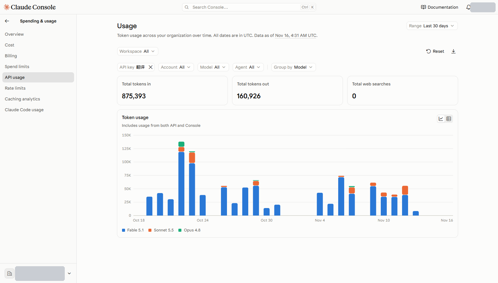</p>

输入 875,393 个 token，输出 160,926 个，差不多 440 次翻译，基本都是 Fable 5.1（橙色和绿色那几小截是被拒后自动换的模型）。我的用法是：每次只框一小块屏幕（一个对话框、一段聊天、几行说明），`effort = low`，平均一次发出去 2000 个 token（大头是截图）、收回来 400 个。按价目表折算，加上月中换了一把 Key 之后那几天的量，这一个月大约 18 美元。

同样这些 token 按官方价目表折算：

| 模型 | 一次 | 这一个月 |
|---|---|---|
| Claude Fable 5.1（我在用的） | 约 0.04 美元 | 约 18 美元 |
| Claude Fable 5.2 | 约 0.03 美元 | 约 14.4 美元 |
| Claude Opus 5.5 | 约 0.015 美元 | 约 7.2 美元 |
| Claude Sonnet 5.5（新装默认） | 约 0.008 美元 | 约 3.6 美元 |
| Claude Haiku 5.5 | 约 0.0004 美元 | 约 0.18 美元 |

Sonnet 的质量已经够用。整屏截图、长文章、把 effort 调高都会贵不少。DeepSeek 这类接口再便宜一个数量级。

## 安装

两种装法，选一种。

**A. 下载即用，不用装 Python**：到 [Releases](../../releases) 下载 `Metaphrasis-版本号-win64.zip`，解压到随便哪个文件夹，双击 `start.bat`。压缩包里自带精简版 Python 和全部依赖，不改系统任何东西，删掉文件夹就算卸载。Windows 第一次运行可能弹出"Windows 已保护你的电脑"，点"更多信息"再点"仍要运行"。

**B. 自己有 Python 的**：
1. Python 3.11 以上都行，我用的 3.14。安装的时候把 Add Python to PATH 勾上。
2. 下载源码（Code → Download ZIP）解压，双击 `install.bat`，装依赖，大概一分钟。
3. 双击 `start.bat`。

装好之后先填 Key：右键托盘图标，点「接口公司」，点你用的那家，把 Key 粘贴到弹出的小窗口里。它会写进程序文件夹里的 `config.ini`，保存就生效，不用重启。用记事本直接改 `config.ini` 也行，填在 `api_key =` 后面。

默认公司是 Claude。同一个菜单里还有 ChatGPT、DeepSeek、通义千问、Kimi、智谱、Gemini 和本地 Ollama，其它用 OpenAI 格式的接口点「自定义接口」填地址。详细的见下面的[公司、模型和思考强度](#公司模型和思考强度)。

`target_language` 默认是中文。想翻成别的语言直接写，比如 English、日本語、한국어，托盘菜单里也能点选，原文是什么语言都行，中文原文也能翻成英文。注意英文比中文长一倍左右，中译英贴回原处时字会小一些，弹窗模式没这个问题。

不能看图的模型也能用，程序发现后会自动只发文字。但这样日文韩文就翻不了，因为文字是 Windows 自带 OCR 认出来的，它只会中英文。

界面语言默认跟随 Windows，托盘菜单里可以切成简体中文、繁體中文、English、日本語、한국어。配置文件里的说明文字有中文和英文两版，跟着界面语言走。

只支持 Windows 10 / 11。

## 使用

| 按键 | 做什么 |
|---|---|
| Alt + ~ | 框选翻译（~ 是 Esc 下面那个键） |
| Ctrl + Alt + Y | 切换 覆盖 / 弹窗 模式 |
| Alt + 1 | 输入框转换：把输入框里打的字原地换成另一种语言 |
| Esc | 取消框选、关掉译文，或者取消正在进行的输入框转换 |

框完等绿圈转完就出来了，按 Esc 或右键菜单里的关闭才会消失，可以拖着走，按住空格能看原文。译文上右键可以复制图片、复制文字、保存图片、重新翻译。

弹窗模式下译文是纯文字，出来的同时进了剪贴板，也可以选一段再复制。

<p align="center">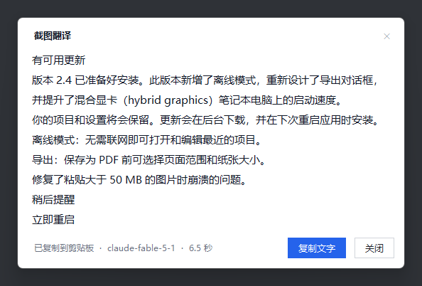</p>

托盘图标右键：显示模式、译文语言、输入框转换成、界面语言、接口公司、模型、思考强度、打开配置、打开翻译记录、开机自启、退出。

框到的本来就是译文语言时不会调接口。

## 输入框转换

在任何能打字的地方都能用：聊天窗口、搜索框、网页里的输入框、文档。用自己的语言打完字，按 Alt + 1，输入框里的字就原地换成另一种语言，默认是英文。说法是口语化的，像母语的人在聊天里会说的那样，不是逐字翻译。

<p align="center">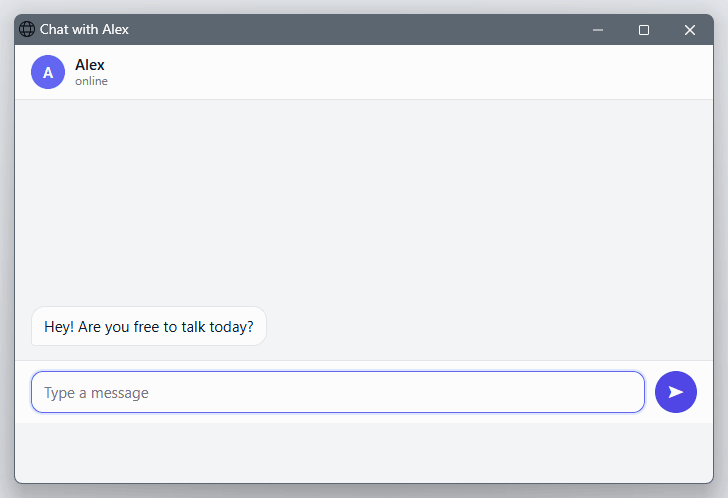</p>

| 你打的 | 按 Alt + 1 之后 |
|---|---|
| 好的，我明天再回你，今天有点忙 | Okay, I'll get back to you tomorrow, I'm a bit busy today. |
| I'll send you the file 等我回家 | I'll send you the file when I get home |
| can you tell me where is the station | Can you tell me where the station is? |
| pls check the readme.md on github, john said its wrong | Please check the readme.md on GitHub, John said it's wrong. |

- 什么都不选就转换整个输入框，选中一段就只换那一段。
- 本来就是目标语言的字不会原样放回去，拼写、语法、语序、大小写和标点都会改好。文件名、路径、命令、代码一个字母都不动。
- 换成哪种语言，在托盘菜单的「输入框转换成」里选，或者在 `config.ini` 里写 `convert_language`，什么语言都行。快捷键想换，在 `[hotkey]` 里加一行 `convert = 组合键`。
- 等结果的时候不想换了，按 Esc 取消，输入框里的字原样不动。字已经开始放进去就来不及了。
- 换上去的是真正的文字，在那个软件里按 Ctrl + Z 可以撤回。
- 等结果的时候点到别处去了也没关系，程序会回到那个输入框把字换好，再把你送回原来的地方。回不去，或者输入框里的内容已经变了，就不动它，把结果放进剪贴板，提示你自己粘贴。
- 一次最多 5000 个字符。

它只往 Windows 确认是输入框的地方发按键。网页正文、图片、只读的文字不会被动，密码框里的内容不读。取字和放回去走的是剪贴板（Ctrl + C / Ctrl + V），因为这是所有软件都支持的办法；你剪贴板里原来的东西（文字、图片、复制的文件）事后会放回去。

有的软件不告诉 Windows 哪里是输入框，这时会提示"这里不是能输入文字的地方"，什么都不做。我测过的是浏览器（Edge、Chromium 内核的窗口）和普通的 Windows 文本框，其它软件不一定都行，遇到不行的请提 Issue。

花费比截图翻译少，因为不发图：一次发出去八百多个 token（大部分是固定的要求），收回来几十到一百多个。按官方价目表折算：

| 模型 | 一次转换 |
|---|---|
| Claude Fable 5.1（我在用的） | 约 0.01 到 0.02 美元 |
| Claude Fable 5.2 | 约 0.01 美元 |
| Claude Opus 5.5 | 约 0.005 美元 |
| Claude Sonnet 5.5（新装默认） | 约 0.003 美元 |
| Claude Haiku 5.5 | 不到 0.0002 美元 |

## 公司、模型和思考强度

这三样都在托盘菜单里，要按顺序来：先选公司，再填这家的 Key，然后才能选模型和思考强度。当前公司还没有 Key 的时候，「模型」和「思考强度」是灰的。

<p align="center">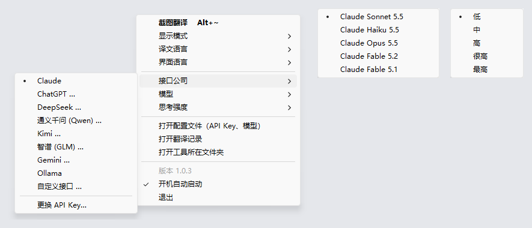</p>

**接口公司。** 名字后面带 … 的是还没填 Key 的。点它会先让你填 Key，保存之前什么都不会变，点取消就还是原来那家。已经填过 Key 的公司点一下直接切过去。最下面的「更换 API Key…」是给当前这家换 Key 用的，Key 到期了就点这里。

<p align="center">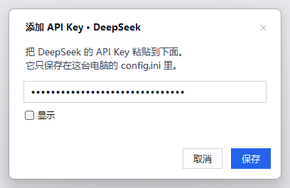</p>

Key 默认显示成圆点，勾了「显示」才是明文，所以把这个窗口截图发给别人也不会泄露。每家公司的 Key、模型和思考强度各存各的，都在 `config.ini` 里。切换的时候把换下来那家的设置收起来，把换上去那家的拿出来，所以一家的 Key 不会被发给另一家。

**模型。** Claude 是固定的五个。其它公司的列表是填好 Key 之后向那家公司自己查的（这个请求不花钱），所以显示的就是你的账号实际能用的。想用的模型不在列表里，就在 `config.ini` 的 `model =` 后面直接写名字。

**思考强度。** 指模型回答之前先推理多久，想得越多越慢、越贵，翻译几行界面文字用最低一档就够。每家公司的选项不一样，因为各家接口的做法本来就不同：

| 公司 | 选项 |
|---|---|
| Claude | 低、中、高、很高、最高 |
| ChatGPT | 默认、关闭思考、低、中、高、很高、最高 |
| DeepSeek | 默认、关闭思考、低、高、最高 |
| 通义千问 | 默认、关闭思考、开启思考、低、高、很高 |
| Kimi | 默认、低、高、最高 |
| 智谱 | 默认、关闭思考、低、高、最高 |
| Gemini | 默认、极低、低、中、高、很高 |
| Ollama | 默认、关闭思考、低、中、高 |

「默认」就是什么都不说，让模型按自己的习惯来。有的公司没有「关闭思考」，是因为它现在的模型一直在思考，关不掉。同一家公司里新老模型认的选项也不完全一样，遇到模型不认的，程序会去掉这个设置再发一次，翻译照样出来，只是那次按模型默认来。

我只有 Claude 的 Key，所以只有 Claude 是连着真实服务测过的。其它几家是照各公司 2026 年 11 月的接口文档写的，用本地的模拟服务检查过。哪家用起来不对，请提 Issue。

## 日文和其它语言

Windows 的 OCR 没有日文也没关系，截图本来就会一起发给模型，模型自己从图上读。装了日语语言包的话译文的位置会贴得更准，不装也能翻，位置是用中文引擎估的。韩文俄文一样。

<p align="center">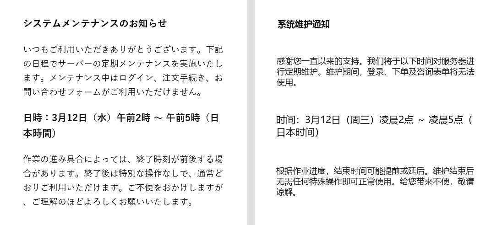</p>

反过来也行。下面是 `target_language = 日本語` 时，英文翻成日文的效果，字体会自动换成 Yu Gothic：

<p align="center">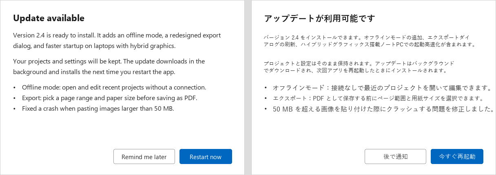</p>

## 被拒绝的问题

各家 AI 服务的安全过滤都有误判的时候，截图里有密钥、密码、权限这类字眼的时候尤其容易，直接不给翻。我自己被拒过很多次，很烦，所以做了几层：

发出去之前先把像密钥、路径、环境变量名的东西换成占位符，翻完再填回去。还是被拒就换一个过滤松一些的模型再试一次（只对 Claude：Fable 最严，Sonnet 松一些；其它接口跳过这步）。再被拒就只发文字不发图。最后还不行就四行四行分开翻，被拦的那几行标出来，其它的照常出。实际用下来基本不会整段白翻。

## 隐私，文件会不会越来越多

默认什么都不留。不记原文译文，不存截图。关掉程序，这个文件夹里多出来的只有一份日志（最多 1 MB，英文），里面只有耗时和报错，不记你翻译的内容。

想留记录的，`config.ini` 的 `[options]` 里有两项：

- `save_history = true`，每次的原文译文追加到 `翻译记录.txt`。
- `save_images = true`，贴好译文的截图按日期存到 `保存的译文` 文件夹。开了这个记得定期清。

框选的那块画面会原样作为图片发给你配的那一个接口，不经过别的服务器；框里看得见的东西，包括密钥和密码，对方都看得到。接口地址如果是不加密的 `http://`，只允许本机和局域网，其它一律拒绝。Key 只在 `config.ini` 里，程序不读不写任何环境变量。记录里要是出现密钥会打码。

输入框转换只在你按下快捷键的那一刻，把那个输入框里的字（选中的那段，或者整框）发给你配的接口，别的不发，密码框不读。日志里只记字数和耗时。开了 `save_history` 的话，转换的原文和结果也会记进去。

## 常见问题

快捷键注册失败：组合键被别的软件占了，到 `config.ini` 的 `[hotkey]` 里换一个，重启。

连不上：要走代理就在 `config.ini` 里填 `proxy`，比如 `http://127.0.0.1:7890`。

Key 到期：Claude 控制台建 Key 的时候默认 30 天有效，建议选 Never。到期了右键托盘图标，「接口公司」→「更换 API Key…」，把新的粘贴进去，不用重启。

按 Alt + 1 说"这里不是能输入文字的地方"：先点一下输入框，让光标在里面再按。还是不行，就是那个软件没告诉 Windows 这是输入框，见[输入框转换](#输入框转换)。

我用的是哪个版本：右键托盘图标，菜单靠下那行灰色的字就是。

程序没了：托盘里没图标就再双击 `start.bat`。要是被别的软件结束了，`guard.pyw` 会在几秒内自动拉起来。

## 不足

OCR 用的是系统自带的，小字、花字、复杂背景认不好，比不上 PaddleOCR 那种专门的。每次翻译三到八秒，是大模型的速度，比机翻慢。不会跟着滚动翻，没有网页双语对照，不是沉浸式翻译那种东西。译文比原文长很多的时候字会缩小或者挤一点。输入框转换靠的是软件自己告诉 Windows 哪里能打字，不这么做的软件里用不了。

## 文件

```
start.bat       启动
install.bat     装依赖
guard.pyw       守护进程，主程序挂了自动拉起
fanyi.py        主程序：托盘、快捷键、框选、显示
translator.py   调接口翻译，防误拒那几层在这里
render.py       把译文排回原来的位置
gdi_text.py     用 Windows 自己的方式画字，和周围的字一样清楚
ocr_win.py      Windows OCR
inputbox.py     输入框转换：认输入框、取字、放回去
settings.py     配置、记录
i18n.py         界面文字的五种语言
appicon.py      图标，是用代码画出来的，没有图片文件
tools/          打包便携版的脚本
其它 .py        小工具
```

MIT 协议，随便改。Issue 和 PR 都欢迎，回得慢请见谅。

名字 metaphrasis 来自希腊语。
